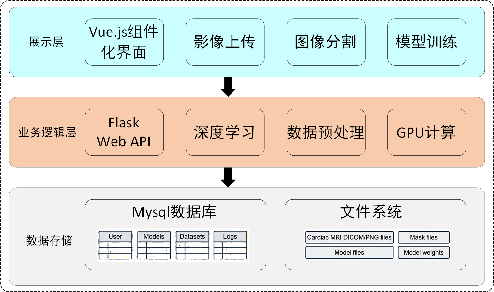
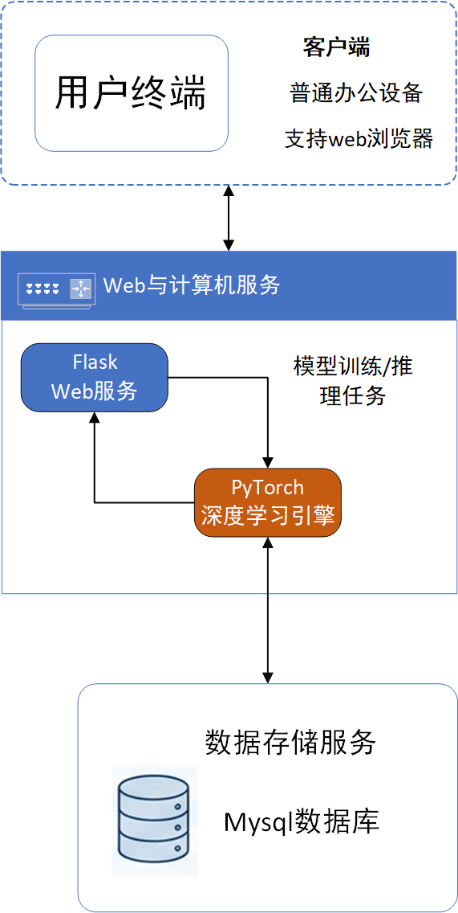
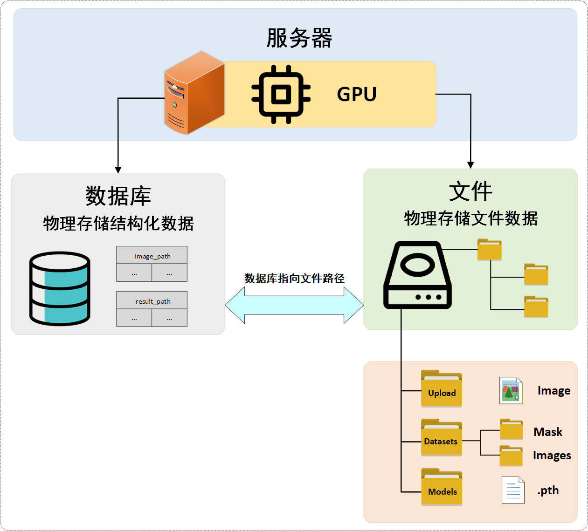
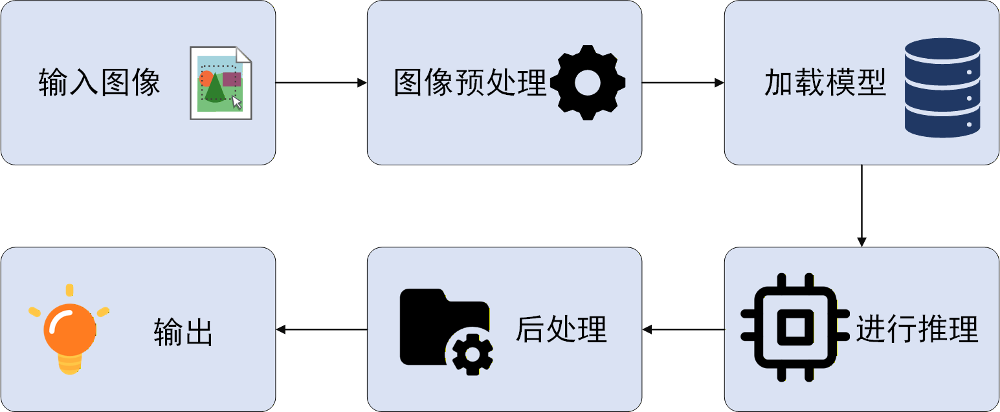

# 架构与流程图集

本图集通过六张 PNG 图片展示平台的系统架构、数据存储、分割算法与业务流程。点击图片可查看大图。

设计图用于说明整体设计，当前可执行行为以源码及[项目 README](../../README.md)为准。

[逻辑架构](#逻辑架构图) · [物理架构](#系统物理架构图) · [数据存储](#数据物理存储结构示意图) · [算法结构](#算法图) · [推理流程](#推理流程图) · [业务流程](#影像分割业务流程图)

## 逻辑架构图

展示 Vue 界面、Flask 业务服务、深度学习模块及存储层的关系。

## 系统物理架构图

展示浏览器客户端、Web 服务、模型计算服务与 MySQL 的部署关系。当前源码将 Web API 和模型任务集成于同一个 Flask 进程。

## 数据物理存储结构示意图

数据库保存文件路径与业务属性，磁盘目录保存影像、数据集和模型权重。

## 算法图

展示 U-Net 编码、解码与跳跃连接的总体结构；实际模型采用 ResNet34 编码器。

## 推理流程图

展示图像输入、预处理、模型加载、前向计算、后处理和输出。

## 影像分割业务流程图

展示从用户请求、文件保存、模型推理到结果持久化与响应的业务流程；计算设备根据环境自动选择 CUDA 或 CPU。

[返回项目首页](../../README.md)
