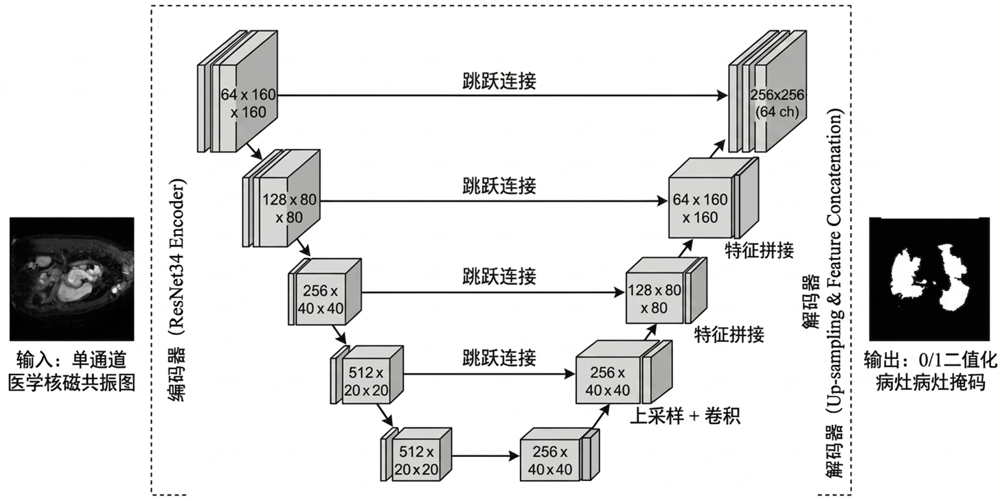
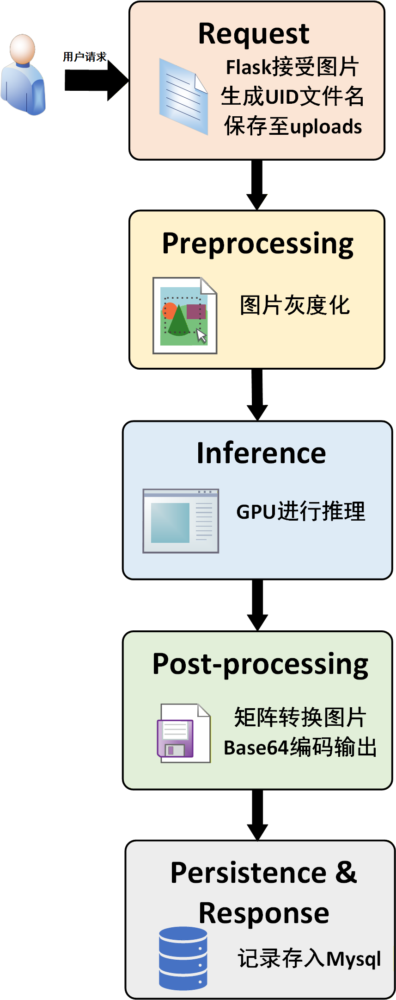

# 架构与流程设计图

本目录收录课程项目提供的六张设计图。PNG 和 SVG 由 Visio 原文件导出，`.vsdx` 可在 Microsoft Visio 中继续编辑。

设计图用于说明整体设计，当前可执行行为以源码及[项目 README](../../README.md)为准。

## 逻辑架构图

展示 Vue 界面、Flask 业务服务、深度学习模块及存储层的关系。

[Visio 原文件](逻辑架构图.vsdx) · [SVG](逻辑架构图.svg)

## 系统物理架构图

展示浏览器客户端、Web 服务、模型计算服务与 MySQL 的部署关系。当前源码将 Web API 和模型任务集成于同一个 Flask 进程。

[Visio 原文件](系统物理架构图.vsdx) · [SVG](系统物理架构图.svg)

## 数据物理存储结构示意图

数据库保存文件路径与业务属性，磁盘目录保存影像、数据集和模型权重。

[Visio 原文件](数据物理存储结构示意图.vsdx) · [SVG](数据物理存储结构示意图.svg)

## 算法图

展示 U-Net 编码、解码与跳跃连接的总体结构；实际模型采用 ResNet34 编码器。

[Visio 原文件](算法图.vsdx) · [SVG](算法图.svg)

## 推理流程图

展示图像输入、预处理、模型加载、前向计算、后处理和输出。

[Visio 原文件](推理流程图.vsdx) · [SVG](推理流程图.svg)

## 影像分割业务流程图

展示从用户请求、文件保存、模型推理到结果持久化与响应的业务流程；计算设备根据环境自动选择 CUDA 或 CPU。

[Visio 原文件](影像分割业务流程图.vsdx) · [SVG](影像分割业务流程图.svg)
